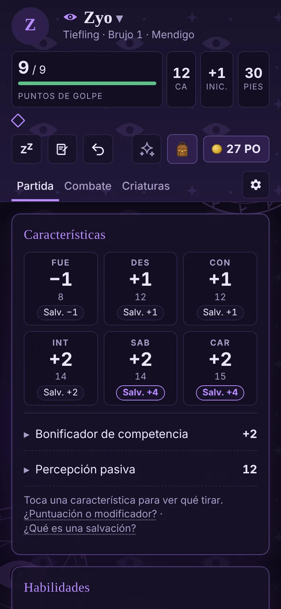
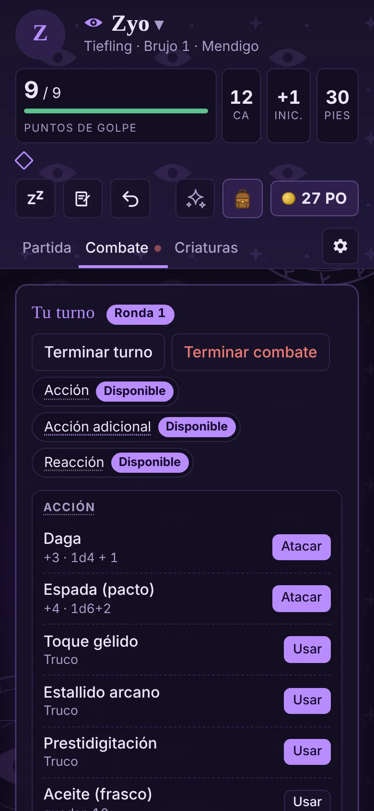
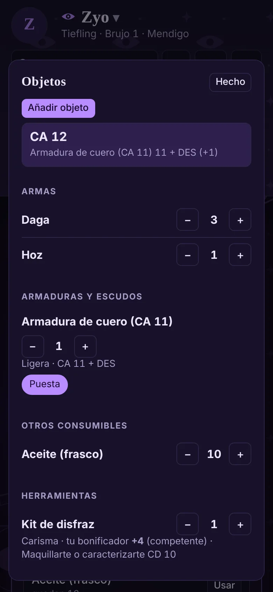
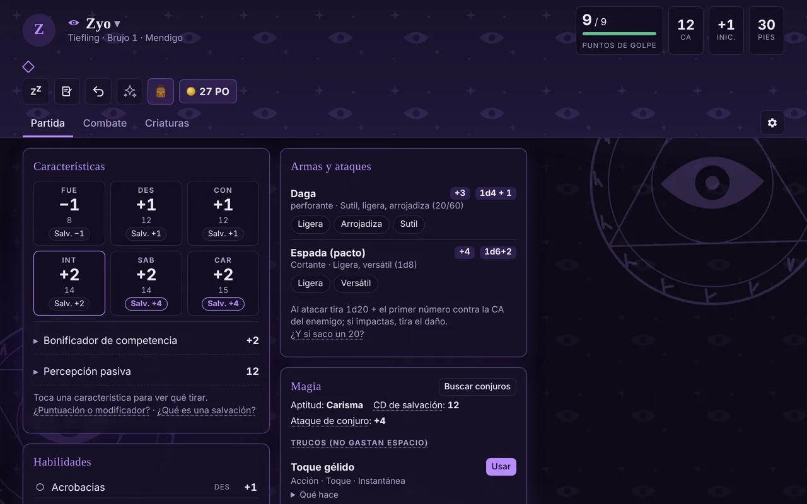

# Fichas 5e

Fichas de personaje interactivas para **Dragones y Mazmorras, 5.ª edición (reglas de 2024)**, en castellano. Es una app web instalable (PWA) pensada para jugar en la mesa con dados físicos: la ficha lleva la cuenta de todo lo que normalmente se apunta a lápiz y explica las reglas justo cuando hacen falta.

**[Abrir la app →](https://albertcontreras98.github.io/Fichas-5e/)**

<p align="center">
  
  
  
</p>
<p align="center">
  
</p>

## Qué hace

- **Partida:** puntos de golpe, PG temporales, salvaciones contra la muerte, estados, agotamiento, inspiración y rasgos con usos limitados.
- **Combate:** botón de iniciar combate con contador de rondas, economía de acciones del turno (acción, acción adicional, reacción y ataques extra) y efectos con duración en rondas o minutos que caducan solos. Al terminar el combate te ofrece limpiar los efectos y estados que ya no tienen sentido.
- **Magia:** espacios de conjuro y de pacto, concentración, conjuros preparados y un buscador con los 339 conjuros del SRD 5.2 traducidos.
- **Inventario:** armas y armaduras que calculan solas el ataque, el daño y la CA. La munición se descuenta al disparar. También gestiona pociones, pergaminos, objetos mágicos con sintonización y monedas con cambio automático.
- **Criaturas:** familiares, invocaciones y compañeros, más formas de Forma salvaje y transformaciones, con un catálogo de 90 criaturas.
- **Asistentes:** para crear personajes (10 especies con sus linajes, 16 trasfondos, dotes de origen) y para subir de nivel (12 clases y 48 subclases). Lo automatizable se aplica solo.
- **Diario de campaña:** carpetas, notas y enlaces entre notas con `[[nombre]]`.
- **Ayuda integrada:** glosario pulsable, visita guiada la primera vez y pistas por sección.
- **Más:** un tema visual propio para cada clase, modo claro y oscuro, deshacer, y exportar o importar fichas en JSON.
- **Sin conexión y sin cuentas:** las fichas se guardan en el propio dispositivo (`localStorage`). No se envía nada a ningún servidor.

## Tecnología

HTML, CSS y JavaScript sin frameworks ni paso de compilación. Se sirve tal cual desde GitHub Pages.

- **PWA:** un service worker (`sw.js`) guarda en caché todos los archivos de la app para que funcione offline. Busca versiones nuevas al volver a la app y recarga sola.
- **Interfaz:** se pinta con plantillas de texto a partir del estado (`render()`), y los botones declaran su acción con `data-act`.
- **Datos de reglas:** van separados del código, en `data/`.

## Estructura

```
index.html              Página única; carga los scripts en orden
sw.js                   Service worker (caché offline y actualizaciones)
manifest.webmanifest    Datos de instalación de la PWA
css/
  app.css               Estilos de la interfaz
  themes.css            Temas por clase (generado con tools/gen_themes.py)
data/                   Datos de reglas: clases, conjuros, orígenes, glosario, criaturas, objetos
js/
  core/                 Constantes, utilidades, modelo de la ficha, cálculos de reglas y efectos
  ui/                   Avisos, ventanas modales y glosario
  views/                Pintado de cada pestaña: barra superior, partida, turno, inventario, editor...
  features/             Módulos completos: asistente, buscador de conjuros, criaturas, diario, tutorial, descansos
  actions/              Qué hace cada botón (data-act), agrupado por área
  events.js             Eventos globales y arranque
  pwa.js                Instalación y registro del service worker
tools/                  Scripts auxiliares
docs/screenshots/       Capturas para este README
```

Los scripts son clásicos (no módulos ES) y comparten el ámbito global, así que **el orden de carga de `index.html` importa**: cada archivo puede usar lo definido en los anteriores.

## Desarrollo

```bash
# Servidor local (cualquier servidor estático sirve)
python3 -m http.server 8000
# → http://localhost:8000

# Formatear el código
npm install
npm run format
```

Para publicar una versión nueva:

1. Sube `VERSION` en `sw.js`. Si añades o renombras un archivo, también hay que actualizarlo en la lista `SHELL` de `sw.js` y en `index.html`.
2. Haz push a `main`. GitHub Pages despliega en un par de minutos y las apps instaladas se actualizan solas la próxima vez que se abren.

Para regenerar los temas por clase: `python3 tools/gen_themes.py css/themes.css`.

## Créditos

Fichas 5e es contenido de fans no oficial permitido bajo la Fan Content Policy. No aprobado ni respaldado por Wizards. Partes de los materiales usados son propiedad de Wizards of the Coast. ©Wizards of the Coast LLC.

Esta app incluye material del System Reference Document 5.2 («SRD 5.2») de Wizards of the Coast LLC, disponible en https://www.dndbeyond.com/srd. El SRD 5.2 tiene licencia Creative Commons Attribution 4.0 International (https://creativecommons.org/licenses/by/4.0/legalcode). Los textos de los conjuros y las criaturas están traducidos y adaptados al castellano. Datos obtenidos de [5e-bits/5e-database](https://github.com/5e-bits/5e-database) (MIT).

Los resúmenes de rasgos de clase y subclase están escritos para esta app y no reproducen el texto del Manual del Jugador.
